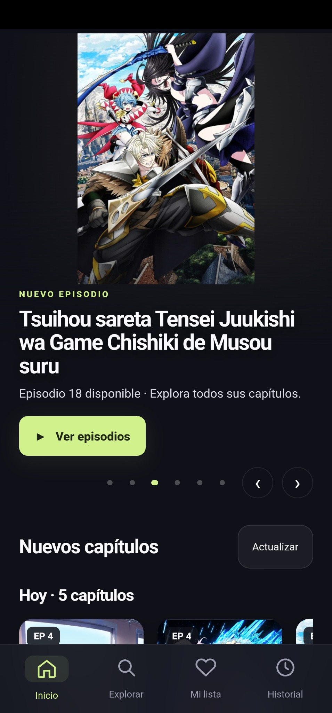
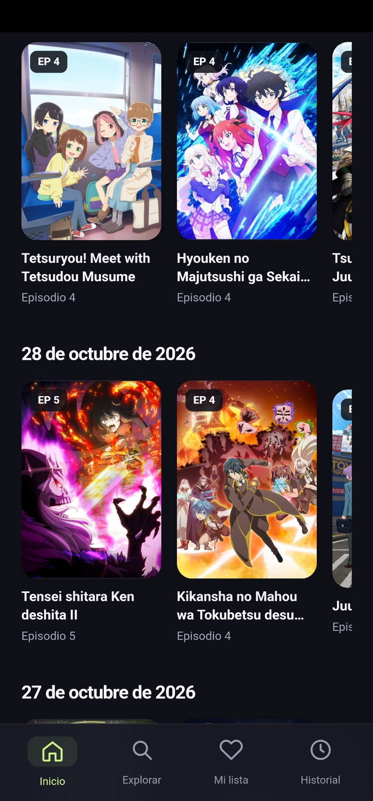
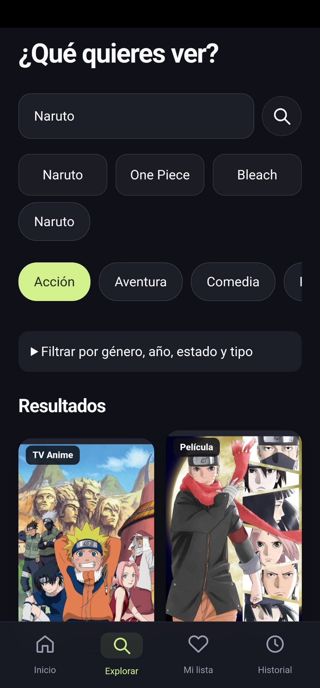
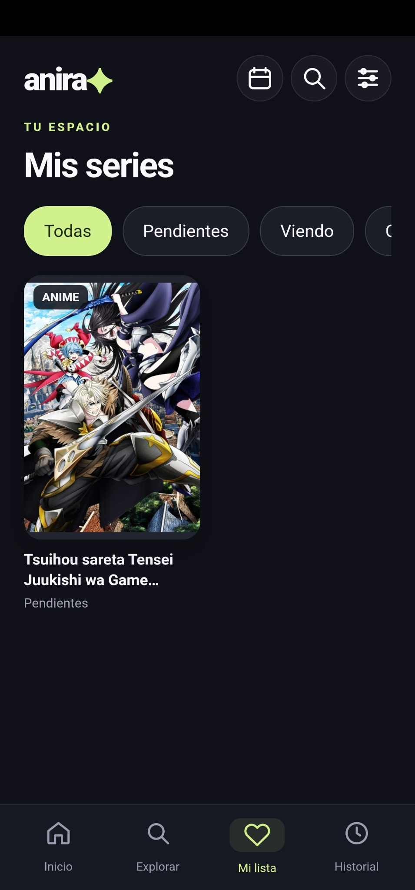
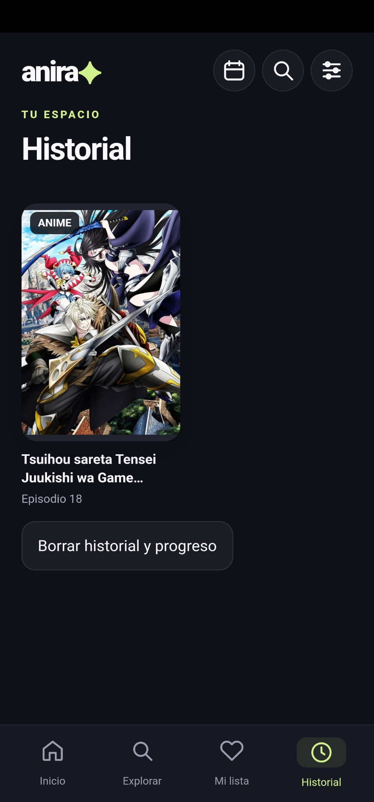

<h1 align="center">Anira</h1>

Tu próxima historia. · Android · Versión 0.13.12

## Acerca de Anira

**Anira — Tu próxima historia**

Descubre anime y manhwa en una aplicación Android con catálogo, recomendaciones, biblioteca personal y lectura vertical. Anira conserva el progreso por perfil y permite retomar episodios y capítulos donde los dejaste.

El catálogo y la reproducción de anime utilizan fuentes externas. El lector de manhwa consulta índices y páginas públicas disponibles; la presencia de títulos, capítulos e imágenes depende de esas fuentes.

**Etiquetas:** `anime` · `manhwa` · `android` · `apk` · `anime-app` · `manga-reader` · `video-player` · `spanish` · `android-tv`

## Capturas reales de Anira

    

Las capturas disponibles corresponden a una versión anterior y no representan todas las pantallas incorporadas después. El catálogo mostrado puede cambiar.

## Descargar

[**Descargar Anira 0.13.12 para Android**](https://github.com/Salvador9797/Anira/releases/download/v0.13.12/Anira-0.13.12.apk)

También puedes abrir la [página de versiones de Anira](https://github.com/Salvador9797/Anira/releases) y descargar el archivo `Anira-0.13.12.apk` desde **Assets**.

- Android 8.0 o posterior.
- Paquete: `app.anira.anime`.
- Versión: `0.13.12` · código `54`.
- Instala encima de la versión anterior para conservar tus datos; no desinstales Anira para actualizar.
- SHA-256: consulta `downloads/SHA256SUMS`.

## Novedades de 0.13.12

Consulta las [notas de cambios desde 0.8.10](RELEASE-NOTES.md). Esta versión incorpora el aviso integrado de actualizaciones. Consulta las notas de cambios desde 0.8.10 para ver el historial completo.

## Qué incluye

### Anime
- Catálogo unificado, búsqueda, filtros y recomendaciones.
- Carrusel principal y secciones de novedades.
- Selección automática de proveedores, con prioridad de AnimeAV1 y TioAnime como respaldo.
- Reproductor con pantalla completa, orientación horizontal, velocidad, calidad, subtítulos y PiP cuando el dispositivo lo admite.
- Continuidad de episodios y progreso separado por perfil.
- Horarios de emisión, avisos opcionales y modo de ahorro de datos.

### Manhwa
- Sección Leer con descubrimiento, búsqueda sobre los títulos cargados y fichas de series.
- Secciones de manwhas recientes, capítulos recientes y recomendaciones cuando la fuente ofrece esos datos.
- Lector vertical con progreso por capítulo y posición de lectura.
- Carrusel «Seguir leyendo».
- Marca de capítulo leído al llegar a la última página visible.
- Navegación al capítulo anterior y al siguiente.
- Biblioteca independiente para anime y manhwa; guardar un título no elimina su progreso al quitarlo de guardados.
- Lecturas y preferencias incluidas en los respaldos compatibles.

### Perfiles y datos
- Perfiles locales con listas, progreso y preferencias separados.
- Avatares y personalización.
- Exportación e importación de respaldos; protección opcional con contraseña.
- Datos locales sin exigir una cuenta de Anira ni un servidor propio.

## Instalar o actualizar

1. Descarga la APK desde el enlace de esta página.
2. Abre el archivo en Android y permite la instalación desde el origen elegido si el sistema lo solicita.
3. Si ya tienes Anira, instala encima de la versión anterior. No la desinstales: así conservas tus datos locales.
4. Se recomienda exportar un respaldo desde Ajustes antes de una actualización importante.

La APK conserva el paquete y el certificado de firma de la aplicación. Si Android indica que la firma no coincide, no fuerces la instalación ni desinstales la versión anterior; informa del mensaje.

## Privacidad y permisos

Anira no necesita una cuenta propia. Listas, historial, progreso y ajustes se guardan localmente, salvo cuando el usuario exporta un respaldo. La aplicación consulta servicios externos para catálogo, imágenes, horarios y reproducción; esas fuentes reciben las solicitudes correspondientes y pueden cambiar o dejar de estar disponibles.

No aloja archivos de video ni garantiza que todos los títulos, capítulos, pistas, idiomas o resoluciones estén disponibles.

## Código y contenido

Este repositorio distribuye la APK oficial, notas de cambios y material de presentación. El código fuente se mantiene en un repositorio privado. No publiques contraseñas, tokens, claves de firma ni datos personales.

## Licencia

**Software propietario · Todos los derechos reservados.** Se permite el uso personal gratuito y compartir la APK oficial sin modificar, con sus avisos. Consulta la [licencia completa](LICENSE) y los [avisos de terceros](THIRD_PARTY_NOTICES.md). Se respetan los permisos válidamente concedidos sobre copias anteriores.
