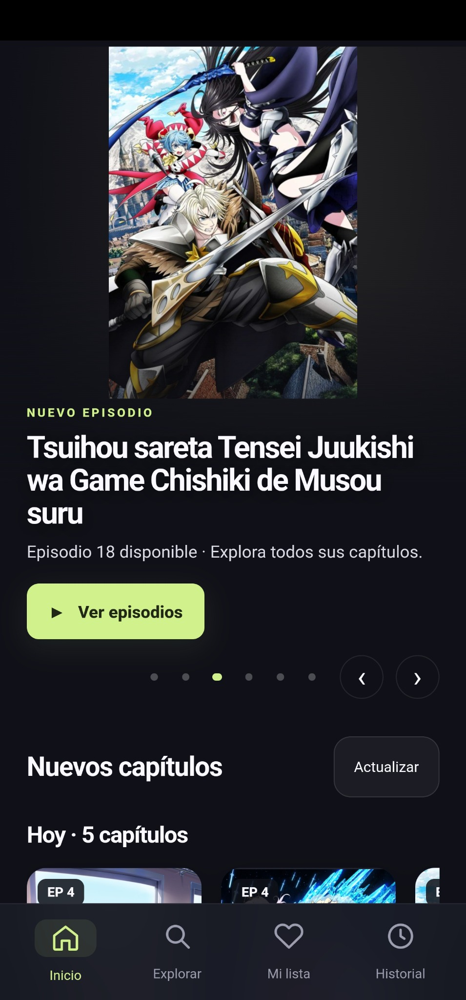
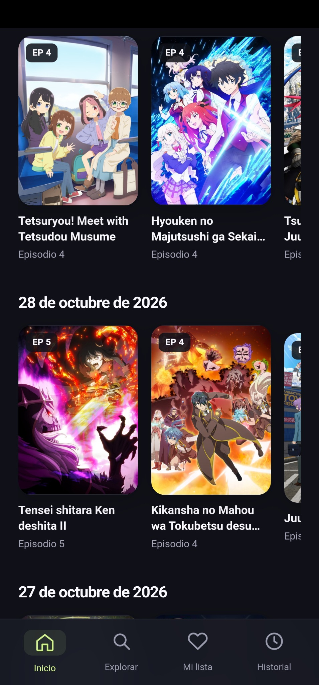
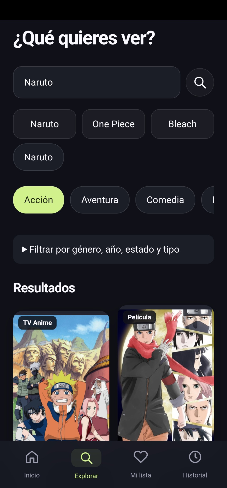
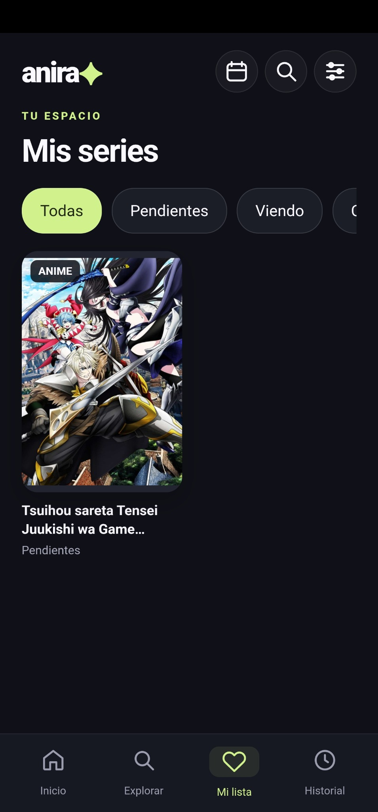

<h1 align="center">Anira</h1>

Tu próxima historia. · Android · Versión 0.6.0

## Acerca de Anira

**Anira — Tu próxima historia**

Descubre anime y organiza tus series favoritas en una interfaz oscura, moderna y fácil de usar. Explora títulos por género, año y estado, consulta nuevos capítulos y retoma tus episodios desde donde los dejaste.

Disfruta de un reproductor con controles de velocidad, calidad, avance y pantalla completa. Guarda tus series como pendientes, viendo o completadas, y conserva tu biblioteca mediante respaldos.

Anira también incluye avisos opcionales de nuevos capítulos y un modo de ahorro de datos que puedes activar o desactivar en Ajustes.

Disponible para Android. El catálogo, los idiomas y la reproducción dependen de la disponibilidad de las fuentes externas.

**Etiquetas:** `anime` · `android` · `apk` · `anime-app` · `video-player` · `anime-catalog` · `watchlist` · `spanish` · `android-tv` · `tablet`

## Capturas reales de Anira

     

Capturas reales de la versión 0.5.0 facilitadas por el usuario. Los nuevos controles de 0.6.0 aún no aparecen en estas capturas. El catálogo mostrado puede cambiar.

## Descargar

[**Descargar Anira 0.6.0 para Android**](downloads/Anira-0.6.0.apk?raw=true)

Android 8.0 o posterior, Android System WebView activo e Internet. Compatible por diseño con celulares, tabletas y Android TV con WebView; reproducción y controles dependen del dispositivo.

**Versión estable.** La actualización 0.6.0 tiene compilación, firma y pruebas de lógica verificadas. PiP y los nuevos controles necesitan comprobación en dispositivo físico. El catálogo, las portadas y los enlaces de reproducción dependen de servicios externos y pueden cambiar o dejar de estar disponibles.

## Qué incluye

- Catálogo, búsqueda y filtros por género, año, estado y tipo.
- Novedades agrupadas por las fechas que publique la fuente.
- Carrusel principal que cambia cada 6 segundos y permite deslizar manualmente.
- Favoritos, series en seguimiento y progreso guardado en el dispositivo.
- Reproductor integrado con ampliación explícita, controles directos y ajuste de imagen.
- Saltos de diez segundos, anterior/siguiente, velocidad, calidad y bloqueo de controles.
- «Saltar introducción» y «Saltar créditos» sin números, solo dentro de intervalos AniSkip compatibles con el episodio y la duración. Datos comunitarios; disponibilidad variable, sin avance aproximado.
- Reproductor flotante PiP mediante botón, sujeto a soporte y permiso de Android.
- Hasta seis perfiles locales, con listas, progreso y preferencias separados.
- Horarios de emisión de las series seguidas, convertidos a República Dominicana; no garantizan cuándo publicará el proveedor.
- Consulta de actualizaciones y descarga oficial, texto grande, reducción de animaciones y diagnóstico técnico.
- Subtítulos externos con tamaño, color, fondo y desfase.
- Ahorro de datos opcional, desactivado inicialmente, desde Ajustes.
- Exportación e importación de listas y progreso.
- Avisos de capítulos nuevos opcionales; Android puede retrasarlos y la fuente puede omitir publicaciones.

Las imágenes superiores son capturas reales de la interfaz de Anira.

## Instalar o actualizar

1. Descarga la APK desde el enlace de este repositorio.
2. Abre el archivo en tu Android. Si el sistema lo pide, permite temporalmente instalar aplicaciones desde el navegador o gestor usado.
3. Si ya tienes Anira, instala encima de la versión anterior para conservar los datos. No es necesario desinstalarla.
4. Si deseas, exporta antes un respaldo en Ajustes.

Nombre del paquete: `app.anira.anime`. Versión: `0.6.0`, código `14`.

La APK conserva el certificado de firma de las versiones anteriores. Su SHA-256 de archivo está en [downloads/SHA256SUMS](downloads/SHA256SUMS).

## Privacidad y permisos

Anira no necesita una cuenta propia. Listas, historial, progreso y ajustes se guardan en el dispositivo, salvo cuando el usuario exporta un respaldo. La app consulta fuentes externas para catálogo, imágenes, horarios y reproducción. La consulta AniSkip envía el identificador MAL, número y duración del episodio; las actualizaciones se consultan en GitHub. Estos servicios reciben las solicitudes de red; esas consultas están sujetas a las políticas de esos servicios.

Usa Internet y consulta el estado de conexión. El permiso de notificaciones se solicita al activar avisos. El control de volumen actúa sobre el audio multimedia. El selector de documentos del sistema se utiliza para respaldos, sin solicitar acceso general a todos los archivos.

## Código y contenido

Este repositorio distribuye la APK y el material de presentación. El código fuente se mantiene en un repositorio privado. No contiene claves de firma ni contraseñas.

Anira no aloja archivos de video. La disponibilidad y calidad dependen de las fuentes externas. No se garantiza la reproducción de todos los títulos, pistas, idiomas o resoluciones.

Para informar un problema, indica versión de Android, modelo, versión de Anira, episodio y pasos para reproducirlo. No publiques contraseñas, tokens ni datos personales.
